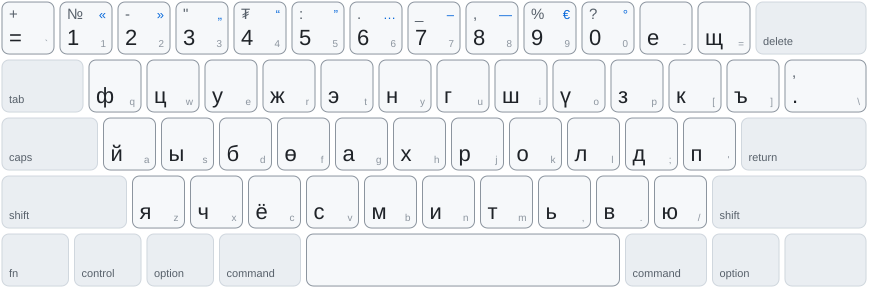
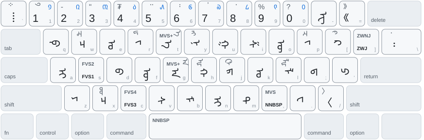

# Modern Mongolian Keyboard for macOS

Built for Mongolian Mac users. Author: **Sodoo**.

Two keyboards for macOS:

- **Mongolian – Modern Cyrillic** (`Мн`): the standard letter positions you already know, but digits without Shift, and Option gives you English.
- **Mongolian – Traditional Script** (`ᠮᠣ`, ᠮᠣᠩᠭᠣᠯ ᠪᠢᠴᠢᠭ): each script letter sits on the key of its Cyrillic letter, so there is no new layout to learn.

Install with one command. No administrator password, no restart, and no trip to System Settings.

## Install

**Terminal (recommended):**

```sh
curl -fsSL https://raw.githubusercontent.com/galaxygliese/Modern-Mongolian-Keyborad-MacOS/main/install.sh | bash
```

Both keyboards are added to the input menu right away. Switch with **Control-Space** or the **Globe (fn)** key.

**Installer package:** download `ModernMongolian-<version>.pkg` from [Releases](https://github.com/galaxygliese/Modern-Mongolian-Keyborad-MacOS/releases) and double-click it. This installs for every user on the Mac. The package is not signed with an Apple Developer ID, so macOS will block the first launch. To allow it, open **System Settings → Privacy & Security** and click **Open Anyway**.

**From a clone:** `./install.sh`

**Uninstall:** `./install.sh --uninstall`, or

```sh
curl -fsSL https://raw.githubusercontent.com/galaxygliese/Modern-Mongolian-Keyborad-MacOS/main/install.sh | bash -s -- --uninstall
```

> If you turned on *Use Caps Lock to switch to and from ABC* (System Settings → Keyboard → Text Input), Caps Lock switches keyboards instead of typing capitals.

## Modern Cyrillic



The large character is what the key types. The small grey character is what it types with **Shift**, and the blue one is what it types with **Shift-Option**.

How it differs from Apple's built-in *Mongolian – Cyrillic*:

| | Apple Mongolian | Modern Cyrillic |
|---|---|---|
| Letters | standard (ФЦУЖЭН) | same |
| Digits | Shift + number row | number row, no Shift |
| `№ - " ₮ : . _ , % ?` | number row | Shift + the same key as before |
| `.` and `,` | number row | also on `\` and Shift-`\` |
| Option + letter | Serbian/Macedonian letters (ј џ ћ …) | English letters (`q w e r t y`) |
| Option + punctuation key | mixed | the US symbol on that key: `[` `]` `;` `'` `,` `.` `/` `\` … |
| Option + number row | `! @ # $ ; ^ & * ( )` | `! @ # $ % ^ & * ( )` |
| Shift-Option + number row | mixed | `« » „ “ ” … – — € °` |
| ⌘ shortcuts | US positions | US positions (⌘C, ⌘V, ⌘Z work) |

**Option = English.** Hold Option to type a quick English word, URL, e-mail address, or code symbol without switching keyboards.

## Traditional Script



Each key types the script letter that its Cyrillic letter is spelled with. **Shift** gives the foreign/Galik variant of that sound:

| Key (Cyrillic) | Types | Shift |
|---|---|---|
| а / э | ᠠ / ᠡ | final ᠠ / ᠡ after a vowel separator (MVS + ᠠ, MVS + ᠡ) |
| н | ᠨ | ᠩ (ng) |
| з, ж | ᠵ | ᠽ (z), ᡁ (zh) |
| ц, ч | ᠴ | ᠼ (ts), ᡂ (ch) |
| х | ᠬ | ᠾ (h) |
| к | ᠺ | ᠻ (kh) |
| р | ᠷ | ᠿ (zr) |
| л | ᠯ | ᡀ (lh) |
| й, и | ᠢ | ᠢ |
| е, я, в, ф, п | ᠧ, ᠶ, ᠸ, ᠹ, ᠫ | same |

Invisible formatting characters are on the keys of Cyrillic letters that have no script counterpart:

| Key | Types | Shift | Purpose |
|---|---|---|---|
| Space | space | NNBSP (U+202F) | joins a case suffix: ᠮᠣᠩᠭᠣᠯ&#x202F;ᠤᠨ |
| ь | NNBSP | MVS (U+180E) | vowel separator before a final ᠠ/ᠡ |
| ы | FVS1 (U+180B) | FVS2 (U+180C) | choose a letter's variant form |
| ё | FVS3 (U+180D) | FVS4 (U+180F) | choose a letter's variant form |
| ъ | ZWJ | ZWNJ | force joining / non-joining |

Punctuation: `\` types ᠃ and Shift-`\` types ᠂. Shift+5/6/8 type ᠄ ᠃ ᠂, `щ` types 《 》, `ю` types 〈 〉, the `` ` `` key types ᠁ ᠅, and Shift+1 and Shift+7 type ᠀ and ᠊. Shift-Option + the number row types Mongolian digits ᠑…᠐. Option works like the Cyrillic keyboard (English letters and US symbols).

Examples (written as the Cyrillic keys you press):

| Text | Keys |
|---|---|
| ᠮᠣᠩᠭᠣᠯ | м о Shift-н г о л |
| ᠮᠣᠩᠭᠣᠯ&#x202F;ᠤᠨ | м о Shift-н г о л, Shift-Space, у н |
| ᠬᠠᠷ᠎ᠠ | х а р Shift-а |

macOS includes the Noto Sans Mongolian font, so script text displays without installing anything else. Most Mac apps show Mongolian lying sideways in horizontal lines. Upright vertical columns depend on the app (on the web, CSS `writing-mode: vertical-lr`).

## Монгол хэлээр

**Суулгах:** Terminal нээгээд дараах командыг ажиллуулна:

```sh
curl -fsSL https://raw.githubusercontent.com/galaxygliese/Modern-Mongolian-Keyborad-MacOS/main/install.sh | bash
```

Хоёр гар шууд нэмэгдэнэ. Control-Space эсвэл Globe (fn) товчоор сольж ашиглана.

- **Кирилл:** үсгийн байрлал стандарт гартай яг ижил. Тоонууд Shift-гүйгээр бичигдэнэ, тэмдэгтүүд Shift дарж хуучин байрандаа бичигдэнэ. Option товч дарвал англи үсэг бичигдэнэ.
- **Монгол бичиг:** үсэг бүр өөрийн кирилл үсгийн товч дээр байрлана (а → ᠠ, н → ᠨ, Shift-н → ᠩ). Shift-Space дарвал NNBSP (нарийн зай), Shift-а дарвал MVS + ᠠ бичигдэнэ.

## Development

The layouts are defined as plain tables in [`scripts/layouts.py`](scripts/layouts.py). Everything else is generated from them.

```sh
python3 scripts/build.py          # regenerate the .keylayout files, Info.plist and charts
swift scripts/make_icons.swift    # regenerate the menu-bar icons
./install.sh                      # install your build for the current user
python3 scripts/verify.py         # check every key × modifier against layouts.py, via macOS itself
scripts/build-pkg.sh              # build dist/ModernMongolian-<version>.pkg and .zip
```

`verify.py` reads each installed keyboard back through macOS (`UCKeyTranslate`). A passing run therefore also shows that macOS accepted the layout files. CI fails when the generated files are out of date with `layouts.py`. To publish the `.pkg` and `.zip` to Releases, push a `v*` tag.

## Author and license

Copyright © 2026 Sodoo. Built for Mongolian Mac users.

Released under the [MIT License](LICENSE).
